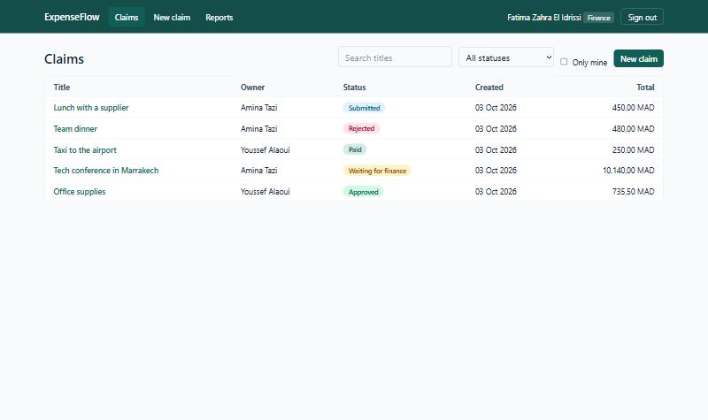
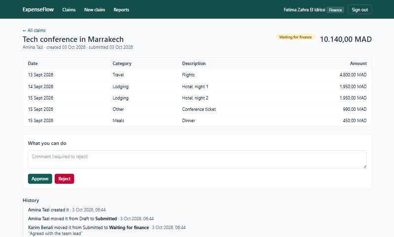
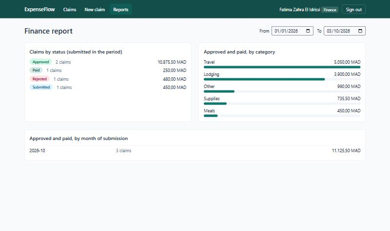

# ExpenseFlow

Expense claims with a two-level approval workflow: employees file claims,
their manager approves them, the finance team gives a second approval above a
threshold and pays. Every change of status is recorded in an audit trail.

**Java 21 · Spring Boot 4.1 · Spring Security (JWT) · Spring Data JPA / Hibernate · PostgreSQL · Flyway · React 19 · TypeScript · TanStack Query · Tailwind CSS · Docker**

[](https://github.com/MedTahaBri2022/expenseflow/actions/workflows/ci.yml)

| Claims (finance view) | A claim waiting for the finance approval |
| --- | --- |
|  |  |



## The workflow

```
DRAFT ──submit──► SUBMITTED ──approve──► APPROVED ──pay──► PAID
                     │   └──approve, total > 10,000 MAD──► PENDING_FINANCE ──approve──► APPROVED
                     └──reject──► REJECTED ◄──reject── PENDING_FINANCE
REJECTED ──reopen──► DRAFT
```

| Role | Can do |
| --- | --- |
| Employee | Create, edit and submit their own claims; reopen a rejected one |
| Manager | The same for their own claims; approve or reject the claims of the people they manage |
| Finance | See every submitted claim; approve claims above the threshold and those of people without a manager; pay approved claims; read the report |

Company rules: a limit per item and category (meals 500 MAD, travel 5,000,
lodging 2,000, supplies 1,500, other 1,000), no expense dated in the future,
amounts with at most two decimals, a reason for every rejection.

## Design decisions

**The rules live in one class.** `ClaimWorkflow` is plain Java, without Spring
or JPA: who may see a claim, who may do which action in which status, and
where each action leads. It has its own unit tests. The API returns
`allowedActions` with each claim, so the React client only shows the buttons it
receives and contains no workflow rule.

**Nobody approves their own claim.** The first approval belongs to the owner's
manager, or to finance when the owner has no manager; a finance user never
approves or pays a claim of their own.

**Drafts are private.** A manager or the finance team sees a claim only once it
is submitted. Visibility is part of the SQL query of the list (JPA
Specification), not a filter applied afterwards, so pagination counts stay
right. A claim you may not see answers `404`, not `403`: its existence is not
revealed.

**Two people cannot both decide.** Every change carries the version the client
read; a stale version is refused with `409`. Two simultaneous decisions on the
same claim are caught by JPA optimistic locking (`@Version`): one wins, the
other gets `409` (tested with two concurrent requests).

**Audit trail.** `claim_event` stores who moved a claim from which status to
which, when and why. The entity is immutable in Hibernate.

**Money.** `BigDecimal` and `NUMERIC(12,2)` end to end, never a float; the total
of a claim is recomputed from its items in the entity.

**Security.** Stateless JWT (HS256) issued at login and validated by Spring
Security's resource server. Passwords hashed with BCrypt; an unknown e-mail
and a wrong password give the same answer in the same time (a dummy hash is
checked). The user is reloaded from the database on every request, so a
deleted account stops working at once. The JWT secret is validated at startup
(at least 32 characters).

**Errors** are RFC 9457 problem documents, with field errors for validation
(`items[1].amount`) that the form shows next to the right input.

**Database.** Flyway migrations, Hibernate in `validate` mode, constraints in
SQL as well (`CHECK` on statuses, amounts and roles, a manager cannot be their
own manager), indexes for the list queries. The list loads owners in the same
query (`@EntityGraph`).

## Run it

Requirements: Docker.

```bash
docker compose up -d --build          # PostgreSQL, API, web
```

Open <http://localhost:8081>. Demo accounts (password `password`, local demo
only):

| E-mail | Role |
| --- | --- |
| `amina.employee@example.com` | Employee (manager: Karim) |
| `youssef.employee@example.com` | Employee (manager: Karim) |
| `karim.manager@example.com` | Manager |
| `fatima.finance@example.com` | Finance |

API documentation (OpenAPI): <http://localhost:8080/swagger-ui.html>.

Front-end development with hot reload, against the API of the stack:

```bash
cd web && npm install && npm run dev  # http://localhost:5180
```

## Tests

```bash
cd api && mvn verify      # needs Docker for Testcontainers
cd web && npm test
```

- **12 unit tests** of the workflow rules (`ClaimWorkflowTest`).
- **24 integration tests** against a real PostgreSQL started by
  Testcontainers, through HTTP with real tokens: login and token handling,
  roles, the whole workflow with its audit trail, the finance threshold,
  self-approval, private drafts, validation and company limits, stale
  versions, two simultaneous decisions, list scope, filters, literal search
  (`%` and `_`), pagination, the finance report.
- **11 front-end tests** (Vitest, Testing Library): the API client (token,
  problem documents, sign-out on 401) and the claim form.
- CI also builds the Docker images, starts the stack and logs in through nginx
  with a demo account.

Coverage report: `api/target/site/jacoco/index.html` after `mvn verify`.

## API

| Method | Path | Notes |
| --- | --- | --- |
| POST | `/api/auth/login` | returns a token and the profile |
| GET | `/api/me` | current user |
| GET | `/api/claims?status=&q=&mine=&page=&size=` | claims visible to the user, newest first |
| POST | `/api/claims` | create a draft |
| GET / PUT | `/api/claims/{id}` | read; replace title and items of a draft (with `version`) |
| POST | `/api/claims/{id}/submit\|approve\|reject\|reopen\|pay` | body `{ "version": n, "comment": "…" }` |
| GET | `/api/claims/{id}/events` | audit trail |
| GET | `/api/reports/summary?from=&to=` | finance only |

## Limits

- No refresh token: the session ends when the access token expires (8 hours by
  default). The token is kept in `localStorage`; an httpOnly cookie would be
  stricter against XSS.
- No receipts upload, no currency other than MAD.
- No rate limiting on the login endpoint.
- Users are created by the demo loader; there is no user administration
  screen.

## License

MIT
